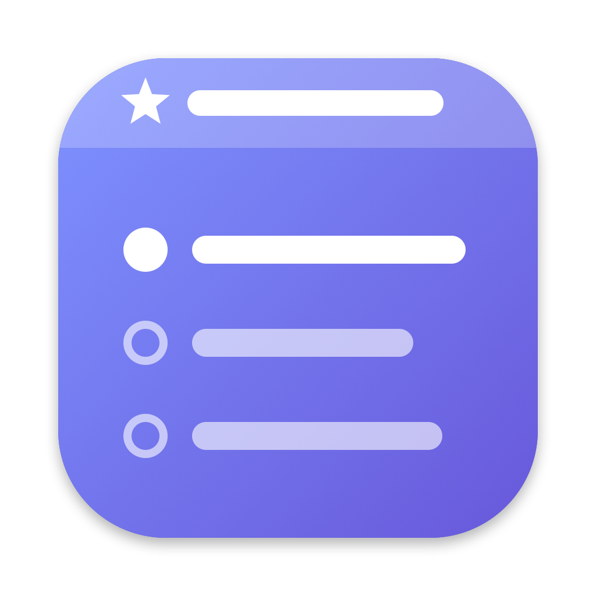

<p align="center">
  
</p>

<h1 align="center">CurrentTask</h1>

<p align="center">A tiny macOS menu bar app that keeps your task list and always shows the one you're working on.</p>

---

The task at the top of your list is shown right in the menu bar, so you always know what you're working on. Click it to open the list, add tasks, reorder them, or tick them off. When you finish the current task, the next one moves up.

## Features

- **Current task in the menu bar.** The top task is shown there, plus a count of the rest, e.g. `Write report (+2)`.
- **Quick add.** Type a task and press Return to add it to the bottom of the list. The ⤒ button next to **Add** puts it at the top instead.
- **Reorder.** Drag rows, or press ⤒ on any row to make it the current task.
- **Done.** ✓ removes a task, and the next one moves up.
- **Persistent.** Tasks are saved automatically and are still there after you quit or restart.
- **Menu bar only.** No Dock icon and no windows to manage.

## Requirements

- macOS 13 Ventura or later on Apple silicon
- Xcode Command Line Tools (`xcode-select --install`). The full Xcode app is not needed.

## Build and run

```bash
./build.sh
open CurrentTask.app
```

`build.sh` compiles `CurrentTask.swift` with `swiftc`, puts it in an app bundle with the icon and an `Info.plist`, and signs it ad hoc so macOS will launch it.

To install it, drag `CurrentTask.app` into `/Applications`. To start it automatically, add it under **System Settings → General → Login Items**.

To rebuild after changes:

```bash
pkill -x CurrentTask; ./build.sh && open CurrentTask.app
```

## Project layout

| Path | What it is |
| --- | --- |
| `CurrentTask.swift` | The whole app: the task list model, the menu bar item, and the popover UI (SwiftUI `MenuBarExtra`). |
| `build.sh` | Builds and signs `CurrentTask.app`. |
| `scripts/make-icon.swift` | Draws the app icon in code and writes `Resources/AppIcon.icns` and `Resources/AppIcon.png`. |
| `Resources/` | The generated icon files. |

## Changing the icon

The icon is drawn in code. To change it, edit `scripts/make-icon.swift`, then regenerate the icon files and rebuild:

```bash
swift scripts/make-icon.swift && ./build.sh
```

## Where your tasks are stored

Tasks are saved as JSON in the app's settings (bundle ID `local.currenttask`), not in this folder, so rebuilding or moving the app doesn't lose them. To start with an empty list:

```bash
pkill -x CurrentTask; defaults delete local.currenttask
```
